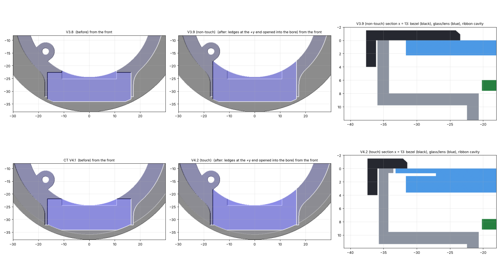
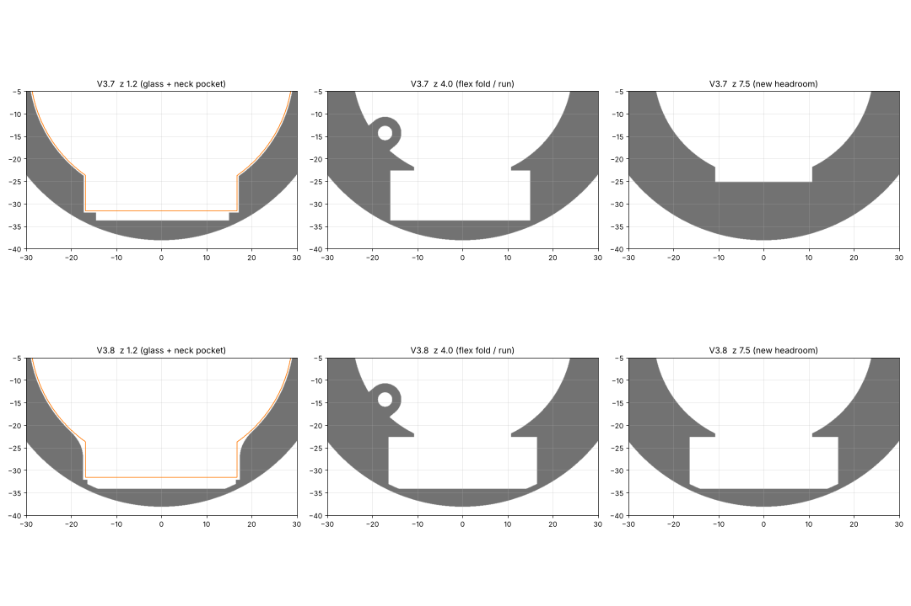
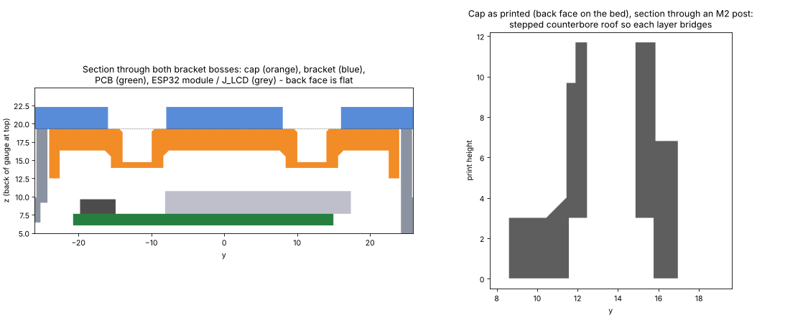
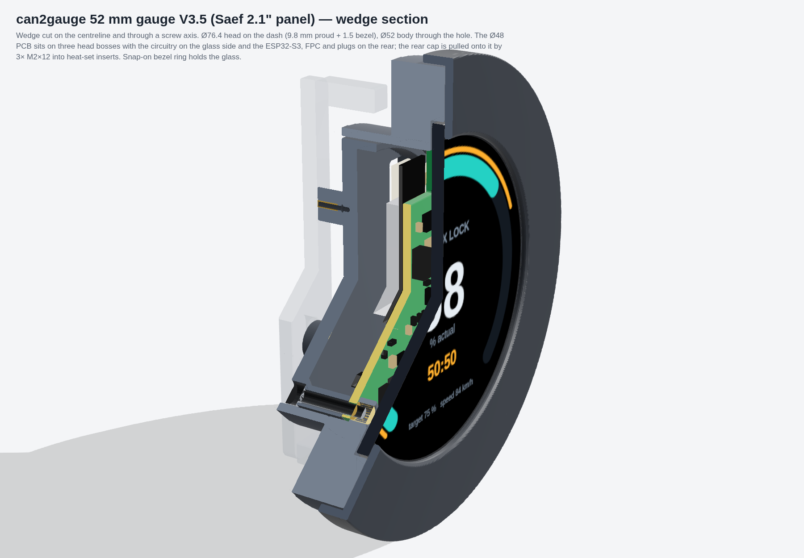
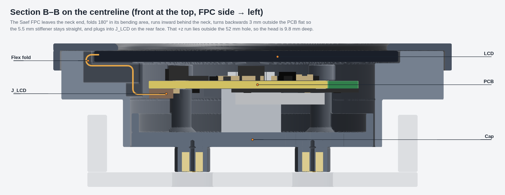
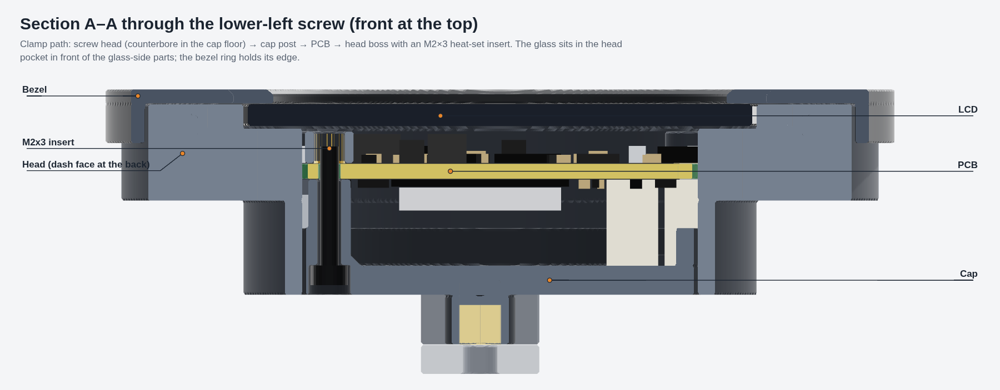
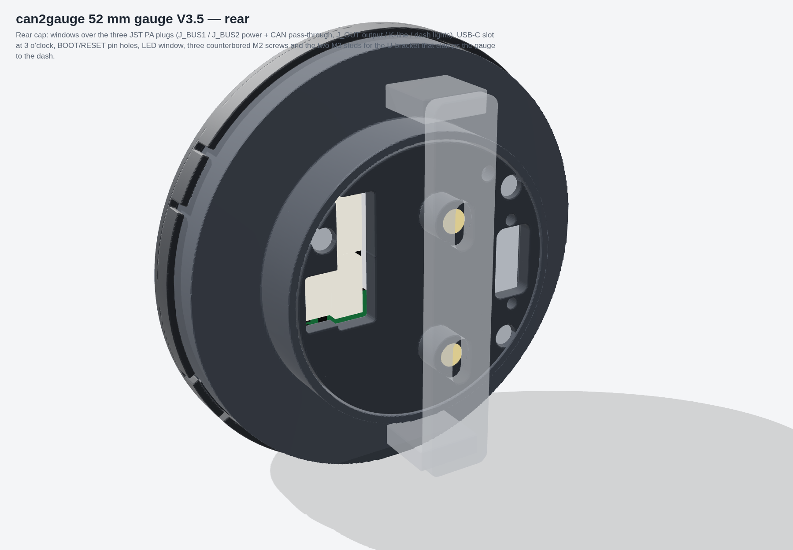

# can2gauge 52 mm housing V3.9 — Saef 2.1" round panel (non-touch), V3.4 board (rev15, M2 holes)

## V3.9 (29 Oct 2026): ribbon cavity opened into the bore

The ribbon cavity under the neck used to stop just short of the +z drop to the connector. That left a small ledge between the cavity and the bore on each side of the drop. The wide part of the ribbon (IC + pads) bowed into those two edges.

- The cavity now runs straight up into the bore across its full width (x −16.4 to +16.5), so both ledges are gone.
- The PCB bosses aren't touched.
- Nothing else changes: the bezel, neck fillet, cap (supportless) and bracket are as in V3.8.



Print `can2gauge_52mm_STL_V3-9.zip` (`pod7b.py` is inside: `ENC_RES=0.2 python pod7b.py out/`).

---

# V3.8 notes
## V3.8 (28 Oct 2026): neck and flex opened out after the first fit

These changes come from your first fit of the panel.

- **Neck corner.** The round pocket and the rectangular neck pocket used to meet in a sharp point of wall. That point dug into the glass's own fillet where the neck joins the circle, which could bind or crack the LCD. They're now blended with an **R3 radius**. The blend is 2D only, so the glass floor stays flat at 2.46.
- **Neck width.** The neck pocket has **0.4 mm** clearance a side beyond the LCM tolerance, up from 0.2.
- **Flex / touch-tail cavity.** On the SFTO210XC drawing, the wide part of the flex (the IC and the 7-pin touch-sensor pads) reaches x +15.3. The model allowed 14.6 + 0.4, so it rubbed and pushed the ribbon out.
  - The fold and run cavity is now **x −16.4 to +16.5**, about 1.2 mm a side for the touch tail and its solder.
  - It runs **0.8 mm further out** past the fold.
  - It's opened **towards the back up to z 8.0**, up from 4.9 / 6.4. That leaves 1.8 mm of head behind it at the dash face.
  - The cavity is clipped at r 37.0, so the head keeps a 1.2 mm wall and stays **Ø76.4**. Nothing else moves.
- **Cap and bracket** are unchanged from V3.7 (supportless cap). The bezel is unchanged.



### SFTO210XC-7478A-CT (new touch panel) against this housing

The LCD module itself is the same size or smaller, so it fits this pocket:

- BL O/D 56.18, compared with the 58.18 frame the pocket is sized for.
- Neck end at the same place, 59.71 from the far edge.
- Neck about 31.4 wide.
- FPC 26.90 long, 20.50 wide, with a 4.50 stiffener.

The cover glass is the difference. It's a **Ø71.27 × 0.7 lens**, bonded to the front, making the module **3.61 mm** deep instead of 2.26. That lens can't go into the Ø58.9 glass pocket, so the touch panel needs a head with a Ø71.6 lens recess and the stack moved back about 1.35 mm. That's a separate version from this one.

Print `can2gauge_52mm_STL_V3-8.zip` (`pod7.py` is inside: `ENC_RES=0.2 python pod7.py out/`).

---

# V3.7 notes
## V3.7 (27 Oct 2026): cap prints without supports

The bracket studs used to stand 5 mm proud of the cap's back face. Whichever way up you printed the cap, something was hanging in the air. V3.7 moves them inside.

- **The back face is now dead flat.** Print the cap back-face-down with supports off. Every inside feature (skirt, posts, bosses) grows straight up off the floor.
- **Bracket bosses** are Ø7.2 and sit on the inside of the floor at the same two spots as before (24 mm apart). They stand 2.4 mm proud of the inner face. Clearances are listed under Checks below.
- **Inserts:** 2 × M3 × 4 heat-set, pressed in **from the back face** into Ø4.0 × 4.6 blind pockets with a 0.4 mm lead-in. The 0.8 mm floor at the bottom of each pocket is a short Ø4 bridge.
- **Bracket:** the bar now sits flat on the cap, so the legs are 5 mm shorter (6.5 mm, still sized for a 3 mm panel). Use **M3 × 6** screws as before. M3 × 7 is the longest that won't bottom out; M3 × 8 is too long.
- **M2 counterbores:** each one has a 0.4 mm slot layer and then a 0.4 mm square layer above its floor (the usual hole-bridging trick). Printed face-down, every layer bridges straight between solid edges instead of hanging a ring round the hole.
- **Unchanged:** body and bezel are geometrically identical to V3.6. Print orientations for those are as before.

**Checks:**

- The only overhangs left on the cap are bridges: the three stepped counterbore roofs, the two Ø4 insert-pocket ends, and a 4 mm² sliver where the J_BUS1 window cuts the MH3 post fillet. That sliver was there in V3.6 too.
- Clearances under the new bosses: 3.2 mm over the ESP32 module (assumed 3.1 mm tall) and 4.3 mm over J_LCD (H2.0). The flex stays below the boss faces.



**Note:** `ProPrj_can2gauge_v3.4-claude-kfix_2026-10-26.epro2` has Ø3.4 (M3) holes at moved positions: (−17.02, 13.84), (−17.15, −13.21), (18.92, 9.91) in the model frame. V3.7 is still drilled for the rev15 M2 board. An M3 version of the body and cap is a separate change.

Print `can2gauge_52mm_STL_V3-7.zip` (`pod6.py` is inside: `python pod6.py out/`, `ENC_RES=0.2`).

---

# V3.6 notes
## V3.6 (4 Oct 2026): M2 insert bosses rebuilt

V3.5's PCB bosses were Ø5.0, with a Ø3.1 hole running straight through. That left about 0.95 mm of wall round an M2 insert, on a 3.2 mm-tall post tied to the bore by a single 3.5 mm web. The insert would burst it or push straight through.

- **Bosses are now Ø7.2,** fused into the bore wall across their full width and full height. That gives 2.0 mm of wall round the insert. Every glass-side part, and the J_BUS1 pin tails, still clears (tightest is C19 at 0.48 mm).
- **Insert pocket:** Ø3.2 × 3.0 from the PCB face, with a 0.3 mm lead-in, for an **M2 × 3** insert (OD ≤ 3.6). Below it is a Ø2.5 relief for the screw tip.
  - The boss can't have a floor: the glass sits 0.3 mm in front of it.
  - Press the insert flush with the boss face.
- **Screws are unchanged:** 3 × M2 × 12 from the back. The tip stops at z 4.3, inside the insert and 1.8 mm clear of the glass.
- **Everything else is the same as V3.5:** bezel, cap, bracket, stack and flex. Only the body changed.
- **Bezel size:** this was looked at and kept. Saef's LCD has a 33.6 mm-wide tab hanging 2.5 mm below the round glass, with its corners at r 35.8. Any round head therefore has to be at least about Ø75, even with no flex fold at all. The fold is already 0.5 mm + R1.1 and only adds 1.75 mm.

Print `can2gauge_52mm_STL_V3-6.zip` (`pod5.py` is inside). V3.5 and older bodies have the weak bosses, so don't print them.

---

# V3.5 notes (still valid apart from the bosses)

A standard 52 mm DIN gauge: the **Ø51.8 body tube** goes through the 52 mm dash hole, the **Ø76.4 head** sits on the dash
and carries the 2.1" panel, the **rear cap** takes every plug, and a **U-bracket** on two M3 studs clamps it to the panel.
Everything is sized from the Saef drawing (SF-TC210B-8947A3N rev A, page 15) and the routed rev15 board file.



## What changed from V3.4 (don't print the V3.4 files)

- **Handedness.** The scripts' frame turned out to be the board seen from the *front* (EasyEDA's top view flipped
  vertically), so every V3.3/V3.4 STL was a mirror image: bosses, cap windows and USB slot on the wrong side.
  `pod4.write_stl()` now mirrors on export. Seen from the rear, the plugs are on the left and the USB-C is on the right,
  as on the real board.
- **Panel.** The LCM is Ø58.18 × 60.71 × 2.26, compared with the Ø56.18 × 59.71 × 3.0 assumed before. The neck is 33.6 mm
  wide, not 23 mm.
- **Flex.** The FPC is 28.7 mm wide for its first 14 mm (15.6 mm on the left where the protect-tape bump is), then
  20.5 mm. It has a 5.0 ± 0.5 mm stiffener that must stay straight, a 3.5 mm contact field and 26.59 mm of length.
- **Stack.** Pocket floor 2.46, PCB 6.0–7.6, dash face 9.8, cap floor 16.3–19.3.
- **Cap.** The cap is generated from the rev15 file itself (`gen_cap4.py`), not from a placement module. Posts are cut
  back where C18, C25, R20 and R_SENSE_A crowd them.

## The flex (and why the head is 9.8 mm deep and Ø76)

```
neck end ── 0.5 straight ── 180° fold R1.1 inside the drawing's bending area (0.5–4.9 mm)
         ── +y run behind the neck at z 3.0 (the 28.7 mm-wide part, 1.9 mm headroom to bow)
         ── 90° to +z at y −23.9 ── +z past the PCB flat ── 90° ── 5.5 mm straight (stiffener) into J_LCD
```

- **Pin 1 checks out.** Seen from the front, the flex has pin 1 on the left. After the fold it lands on J_LCD pad 1,
  so the rev15 pinout (1 LEDA … 40 GND, DB0/DB12 = GND for RGB565) needs no change.
- **Length.** The route needs 23.7 mm of the 26.59 mm available. The 2.85 mm of slack bows in the head channel.
- **Head depth.** The stiffener has to stay straight, so the backwards run sits 3 mm outside the flat. Its 20.5 mm-wide
  corners are at r 26.1, outside the 52 mm hole, so that run has to stay inside the head. That sets the dash face at
  9.8 mm (11.3 mm proud with the bezel).
- **Head diameter.** The 28.7 mm-wide fold beyond the neck end sets the head at Ø76.4.
- **Shorter stiffener option.** If Saef can make the stiffener 3.5 mm (flush with the contacts), the +z run moves inside
  the bore and the head can come down to about 7 mm. Ask on the quote.



## Stack and retention

```
 front  bezel ring   −1.5 .. 0     window Ø53.6 (AA 53.28), lip over the LCM edge; snap-on, carries no load
        LCM           0 .. 2.26    pocket Ø58.9 + neck pocket 34.4 wide; pocket floor 2.46 (LCM +0.2 tolerance)
        0.5 mm air                 to the tallest glass-side part (3.0 mm: RS0530, FNR4030)
        PCB          6.0 .. 7.6    on three head bosses (V3.6: O7.2 fused to the wall, M2x3 insert in a O3.2x3 pocket)
        dash face    9.8           head rear face; Ø51.8 tube behind it
        cap floor   16.3 .. 19.3   USB-C (10.0) pokes 1.3 into its slot, JST PA assumed ≤ 9.0
 back   studs       19.3 .. 24.3   M3x4 inserts for the bracket (legs sized for a 3 mm panel)
```

3x **M2x12** from the back: counterbore → cap post → PCB → head-boss insert (tip at z 4.3, well clear of the glass).



## Rear cap

The cap has these openings:

- One window per JST PA plug (body + 0.8 mm for the latch; J_BUS2 and J_OUT merge).
- A 13 × 7 slot for the USB-C overmold.
- Ø2 holes over BOOT and RESET.
- A Ø2.6 window over the power LED.
- The counterbores for the three M2 heads.



## Assembly

1. Press the inserts: 3x M2x3 in the head bosses (from the PCB side, flush), 2x M3x4 in the cap studs.
2. Peel the panel's pull tape. Put the glass in from the front with the neck at 6 o'clock, then snap the bezel on.
3. Plug the flex into J_LCD first. Then lay the PCB glass-side down on the bosses, folding the flex into the head
   channel under the neck. The fold goes in the bending area, not at the stiffener.
4. Fit the cap and 3x M2x12 screws. Snug them only.
5. Push the body through the dash, then fit the bracket with 2x M3x6.

## Checks (`python assembly4.py <rev15 .epru> out/asm4`)

No interference was found for:

- All 115 bodies and solder tails against the body, head and cap.
- The LCM, PCB, cap and bezel against the body.
- The flex (real outline, both faces) against the body, cap, PCB, LCM and every glass-side part.
- The flex against the 52 mm hole.

## Files

- `can2gauge_52mm_STL_V3-5.zip`: body, bezel, cap and bracket, right-handed with outward normals.
  - Print the body head-down, the bezel face-down, the cap back-face-down and the bracket flat.
  - Use PETG or ASA.
- `pod4.py`: the model. `python pod4.py out/` writes the STLs and prints the flex budget.
- `gen_cap4.py` → `cap4.py`: cap openings and post keep-outs, generated from the EasyEDA file.
- `assembly4.py`: the full assembly and interference check. `render/` holds the three.js cutaway renderer.
- `v3-4/` and older: superseded (mirrored). Don't print them.
