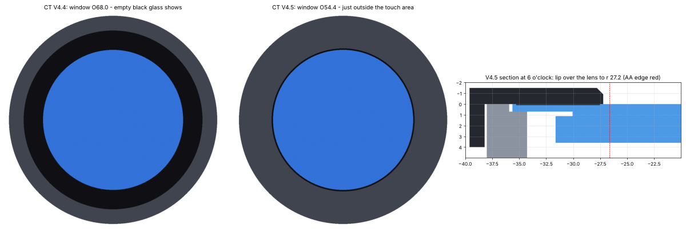
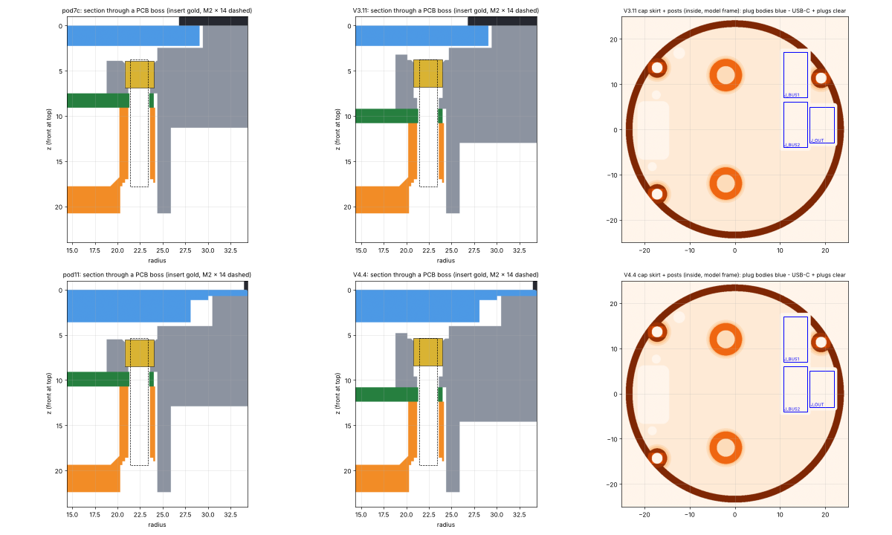
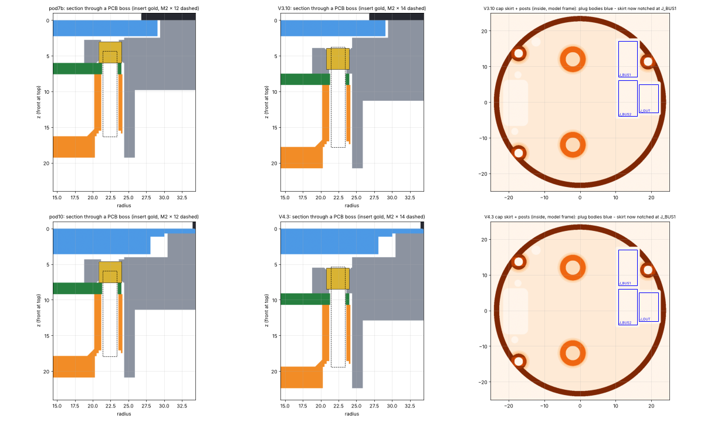
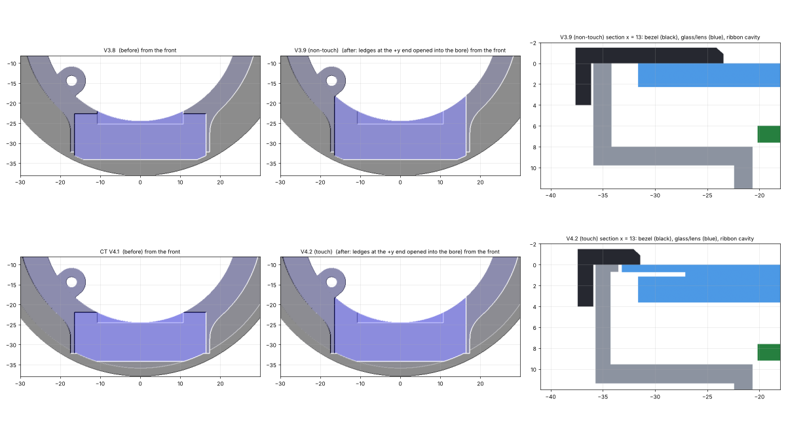
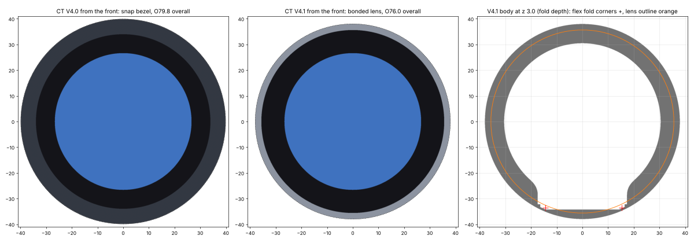
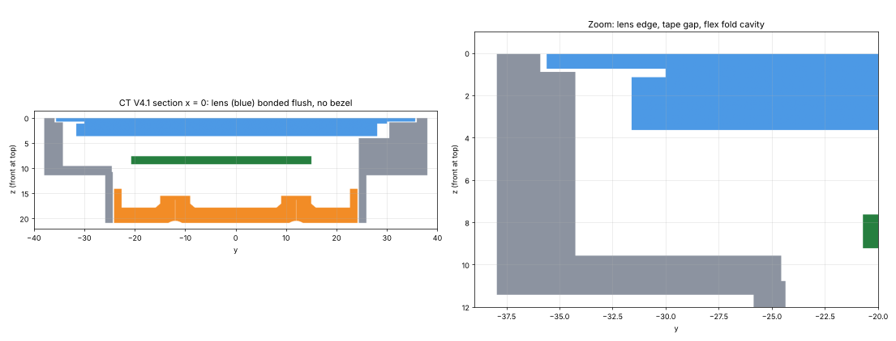
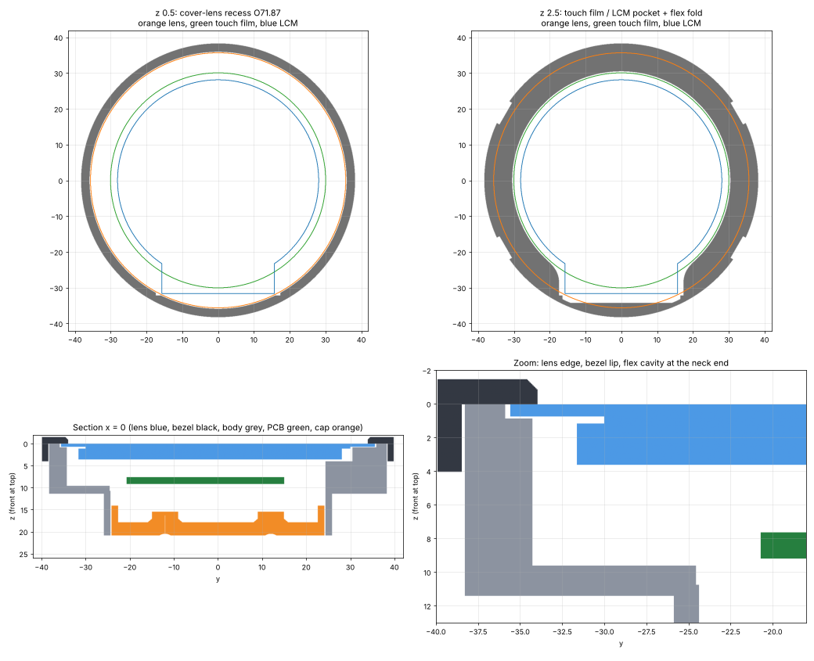

# can2gauge 52 mm housing CT V4.5: Saef SFTO210XC-7478A-CT touch panel

## CT V4.5 (6 Nov 2026): bezel brought in over the empty glass

The panels have arrived and fit well. The only change in this version is the bezel.

- **The bezel window is Ø54.4, down from Ø68.0.** That's the touch area (VA 53.88) plus 0.26 mm a side. The bezel now covers the lens's empty black border, and the whole display area (AA 53.28) stays clear.
- The 0.6 × 45° chamfer on the window edge stays, so the edge doesn't shadow the display at an angle.
- The lip still clamps the lens at its outer edge with the 0.1 mm bead. The overall size is unchanged at Ø79.2.
- **Body, cap and bracket are identical to V4.4.** If those are already printed, just reprint the bezel.

Print `can2gauge_52mm_STL_CT_V4-5.zip` (`pod13.py` is inside: `ENC_RES=0.2 python pod13.py out/`; the bezel is meshed at `ENC_RES=0.15`).

---

# CT V4.4 notes
## CT V4.4 (6 Nov 2026): tall PCB tabs, inserts recessed from the front, USB-C flush with the cap

- **PCB raised further: 3.2 mm behind V3.9 / V4.2 in total.** The USB-C now finishes flush with the back face of the cap. The cap back and the tube end stay where V3.10 / V4.3 had them, and the cap floor sits 1.7 mm closer to the PCB.
- **Tall tabs, 6.0 mm**, up from 3.6. From the front they go:
  1. a **Ø4.6 × 0.6 recess**. The insert sits 0.6 mm below the tab face, and any plastic that wells up while pressing stays in the recess, so nothing stands proud towards the screen;
  2. the **Ø3.2 × 3.0 insert pocket** (M2 × 3), with a 0.3 mm lead-in at its mouth;
  3. a **1.2 mm melt trap** past the insert, for the plastic pushed ahead of it;
  4. a **1.2 mm solid shoulder** at the PCB face (Ø2.4 screw clearance). The screw pulls the insert back against it.
- Clearances: the tab face is 1.0 mm from the panel's worst-case back face, and the insert is 1.6 mm from it.
- **Screws: still M2 × 14** through the cap posts. The tip finishes at the front of the insert, so the full 3 mm is engaged.
- **Cap:** still clear of all three JST plugs, the USB-C (its slot now cuts through the skirt too), the ESP32 module and J_LCD. The bracket bosses inside the cap clear the module by 1.5 mm.
- **Head:** 14.6 mm deep at the dash face, because the ribbon's backward run grows with the PCB. The bracket legs are regenerated to suit.
- **Ribbon:** the datasheet figures say this uses all the slack (the model route needs 27.5 mm against 26.9 nominal / 26.4 worst case). You've seen the real slack, so I've built it as asked. Check it on the first fit, and if it's tight I'll pull the PCB back towards the screen in that version.
- Still M2, rev15 board.
- The bezel, lens recess and slim head are unchanged.

**Assembly:** press the inserts into the tabs from the front, down to the floor of the recess. Then fit the panel and bezel, then the PCB and cap with 3 × M2 × 14.

Print `can2gauge_52mm_STL_CT_V4-4.zip` (`pod12.py` is inside: `ENC_RES=0.2 python pod12.py out/`; bezel at `ENC_RES=0.15`).

---

# CT V4.3 notes
## CT V4.3 (6 Nov 2026): bosses raised, inserts from the front, cap clears the JST plug

- **PCB raised 1.5 mm (bosses further back).** The screen PCB sits 1.5 mm further from the panel, which the ribbon slack allows.
  - The three bosses now stand clear of the panel. Their front faces are 1.7 mm behind the panel's worst-case back face.
  - **The M2 × 3 inserts go in from the front**, from the glass side before the panel is fitted. The pocket (Ø3.2 × 3.0, with a 0.3 mm lead-in) is open at the boss front, so the melt has room to go and isn't trapped behind plastic.
  - The screw pulls the insert back against a 0.6 mm shoulder at the PCB face (Ø2.4 screw clearance), so it can't pull through.
  - **Screws are now M2 × 14** from the back through the cap posts. That gives the full 3 mm in the insert, with the tip 0.1 mm past the insert front and well clear of the panel. M2 × 12 would only reach about 1 mm into the insert.
  - Ribbon: needs 25.8 mm of the worst-case 26.4 (0.6 mm slack; 1.1 mm at the nominal 26.9 length).
  - The head is 1.5 mm deeper (dash face at z 12.9).
- **Cap skirt cleared for the JST plug.** The cap's inner skirt clipped the corner of the J_BUS1 plug. The plug windows now cut through the skirt as well, and a check of all three plug bodies against the cap shows no overlap.
- **Still M2 for now**, still drilled for the rev15 board. Everything else is as before.
- The bezel, lens recess and slim head are unchanged from V4.2.

**Assembly change:** press the three inserts into the bosses **from the front**, flush with the boss face, before the panel goes in. Then fit the panel, snap on the bezel, and fit the PCB and cap with 3 × M2 × 14.

Print `can2gauge_52mm_STL_CT_V4-3.zip` (`pod11.py` is inside: `ENC_RES=0.2 python pod11.py out/`; bezel meshed at `ENC_RES=0.15`).

---

# CT V4.2 notes
## V4.2 (29 Oct 2026): bezel back, ribbon cavity opened

- **Snap-on full-face bezel is back.** No tape: the lens sits straight on the recess floor (recess now 0.70 deep, so the lens front is flush). The bezel clamps it.
  - The bezel window is Ø68.0, with a 1.6 mm lip over the lens edge and a 0.1 mm bead under the lip, so the lens is held all round.
  - It snaps on with the four hooks at 30 / 150 / 210 / 330°. Those are well clear of the ribbon's fold corners at about 245° and 295°.
  - It keeps the slimmer V4.1 head (Ø76.0), so the overall size is **Ø79.2** (V4.0 was 79.8).
- **Ribbon cavity opened into the bore.** This is the same fix as non-touch V3.9: the two ledges at the +y end of the run either side of the +z drop are gone, so the wide part of the ribbon has room to bow.
- **Unchanged from V4.1:** stack, pockets, flex fold, board fit, cap (supportless) and bracket. The trim ring is dropped; the bezel replaces it.

**Assembly:** put the panel in from the front, neck at 6 o'clock, lens down flat in its recess. Then snap the bezel on.

**Print:** body head-down, bezel face-down, cap back-face-down (no supports), bracket flat.

Print `can2gauge_52mm_STL_CT_V4-2.zip` (`pod10.py` is inside: `ENC_RES=0.2 python pod10.py out/`; the bezel was meshed at `ENC_RES=0.15` for the bead).

---

# CT V4.1 notes (superseded: no bezel, taped lens)
## V4.1 (28 Oct 2026): as slim as the panel allows

The overall diameter is down from **Ø79.8 to Ø76.0**, and the face sits 1.5 mm lower.

- **No snap bezel.** The lens is the face: it sits flush in its Ø71.87 recess, held by the tape ring. Use about 0.15 mm double-sided / adhesive-transfer tape, such as 3M 468MP at 0.13 mm.
  - The head shows a 2.0 mm rim round the lens.
  - The lens's own black border does the bezel's job.
  - The bezel's snap pockets in the head are gone.
- **Head Ø76.0**, down from 76.6. Two things set this:
  - the lens recess plus a 1.2 mm rim, which would allow Ø74.3;
  - the two corners of the flex where it folds back behind the display, which are the real limit. The wide part (IC and touch pads) is x −14.5 to +15.3 at the fold apex, which puts the corners at r 36.8.
  - The fold cavity stops 0.35 mm past those corners, with a 0.8 mm wall behind them. That's the thinnest wall in the part, and it's only at those two corners.
  - The fold is already the tightest the datasheet allows: 0.5 mm straight from the TFT edge, then R1.2 to clear the 2.48 LCM.
- **Optional trim ring** (`_trim-ring-optional_`): glue it onto the head face if you want a mechanical lip as well as the tape.
  - It's 0.6 mm thick, with the same OD as the head, so it adds nothing to the diameter.
  - It covers 0.8 mm of the lens edge.
- **Unchanged from V4.0:** stack, pockets, flex, board fit, cap (supportless) and bracket.

**Assembly change:** lay the tape ring on the recess floor (r 30.5 to 35.9; it can't go over the fold cavity at 6 o'clock), then press the lens down flush. That's it: there's no bezel to snap on.

**Print:** body head-down, cap back-face-down (no supports), bracket and trim ring flat.

Print `can2gauge_52mm_STL_CT_V4-1.zip` (`pod9.py` is inside: `ENC_RES=0.2 python pod9.py out/`).

---

# CT V4.0 notes (still valid apart from the bezel and head size)
This is a separate version for the touch panel. It's built from V3.8, so it keeps the opened-out flex cavity, the V3.7 supportless cap and the inside bracket bosses. It's for the rev15 board (V3.4, M2 holes). Keep using V3.8 for the non-touch SF-TC210B panel.

It's built from the SFTO210XC-7478A-CT drawing (rev 01, 2026-03-06):

- **Cover lens:** Ø71.27 ± 0.1 × 0.7 mm.
- **Touch film:** G+F, Ø60.08, with a flat bottom 62.19 mm from its top edge (about 32 mm wide).
- **Depth:** 3.61 ± 0.2 overall, fully laminated. The LCM alone is 2.48 ± 0.2.
- **LCM:** BL O/D 56.18. The neck end is at the same place as before, and the neck is about 31.4 mm wide.
- **FPC:** 26.90 ± 0.5 long, 20.50 wide, with a 4.50 ± 0.3 stiffener.

## What's different from V3.8

- **Lens recess.** The front of the head has a Ø71.87 × 0.85 recess, and the lens front sits flush with the head face.
  - The lens's outer ring (outside the touch film) rests on a **0.15 mm double-sided tape ring** on the recess floor. Use a ring about 5 mm wide between r 30.5 and 35.9.
  - The tape is part of the stack. Without it, the lens sits 0.15 mm low and the bezel won't clamp it.
- **Touch film / LCM pocket.** This is one pocket shaped as the hull of the Ø60.08 film and its bottom flat, with tangent sides. It has 0.2 tolerance plus 0.25 clearance all round, so there's no corner anywhere for the panel to bind on.
  - The neck pocket from V3.8 (0.4 mm a side, R3 blend) is still in there.
  - The pocket floor is 0.2 mm behind the worst-case LCM back, so the lens carries the module and the LCM never bottoms out.
- **Stack.** The panel is 1.35 mm deeper than the old one, so everything behind it moves back about 1.6 mm:

  | | Old | Now |
  |---|---|---|
  | PCB | 6.0–7.6 | 7.6–9.2 |
  | Dash face (head rear) | 9.8 | 11.4 |
  | Cap floor | 16.3–19.3 | 17.9–20.9 |

  - Relative to the PCB, nothing has changed. The glass-side parts get 3.8 mm (3.0 needed), and the bosses, inserts, screws and cap are the same.
  - The head stands 11.4 mm proud of the dash, plus 1.5 for the bezel.
  - The bracket legs are generated for a 3 mm panel, as before.
- **Flex.**
  - The 180° fold is now R1.2, so the run comes back at z 4.33, clear of the thicker LCM.
  - Needed: 24.3 mm of the worst-case 26.4 (2.1 mm of slack).
  - The stiffener is now worst-case 4.8 mm, and it stays straight.
  - The fold / touch-tail cavity starts behind the lens ring and goes back to 1.83 mm short of the dash face.
- **Head size.** The head is Ø76.6, up from 76.4, because of the bigger fold. The lens recess leaves a 2.3 mm wall.
- **Bezel.**
  - The window is now **Ø68.0**: a 1.6 mm lip over the lens edge, so the lens's black border shows.
  - A 0.1 mm bead under the lip, at r 34.3–35.3, clamps the lens into its tape.
  - The snap hooks are unchanged.

## Board check (rev15)

- **Touch lines.** J_LCD already matches this panel's touch pins:

  | Pin | Panel | rev15 net |
  |---|---|---|
  | 35 | TP_INT | TP_INT |
  | 36 | TP_SDA | SDA |
  | 37 | TP_SCL | SCL |
  | 38 | TP_RESET | TP_RST |
  | 39 | TP_VCI | 3V3 |
  | 40 | GND | GND |

  Pins 1–34 match too: LEDA, LEDK × 2, GND, VCI, RESET, SPI, RGB, with DB0 / DB12 tied to GND for RGB565.
- **Backlight.** It's 80 mA at 5–7 V (dual-chip LEDs), which is what the V3.4 review assumed.

## Assembly

1. Press the inserts: 3 × M2 × 3 in the head bosses (flush), and 2 × M3 × 4 into the cap from its back face.
2. Lay the tape ring in the lens recess, then peel it. Put the panel in from the front with the neck at 6 o'clock and press the lens down onto the tape. Snap the bezel on.
3. Plug the flex into J_LCD. Lay the PCB on the bosses with the fold in the cavity under the neck. The touch tail sits in the same cavity.
4. Fit the cap with 3 × M2 × 12, snugged only. Fit the bracket with 2 × M3 × 6.

## Print

- **Body:** head (lens face) down. The pocket and recess ledges need the same supports as V3.x.
- **Bezel:** face down.
- **Cap:** back face down, no supports.
- **Bracket:** flat.
- **Material:** PETG or ASA.

The meshes are watertight and manifold.

## Files

- `can2gauge_52mm_CT_body_V4-0.stl`, `_bezel_`, `_cap_`, `_bracket_`
- `pod8.py`: the model. Run `ENC_RES=0.2 python pod8.py out/`. It needs `geom.py` and `cap4.py`.
- `can2gauge_CT_V4-0_sections.png`
