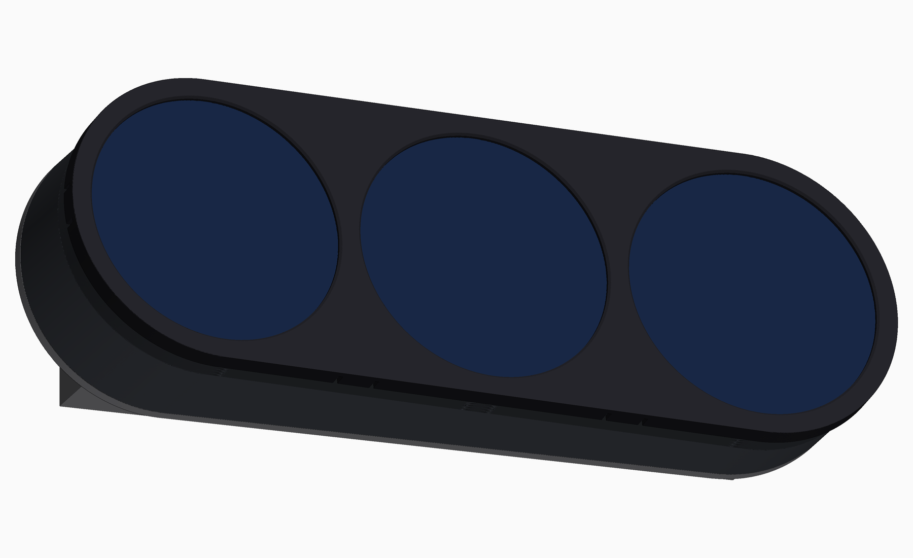
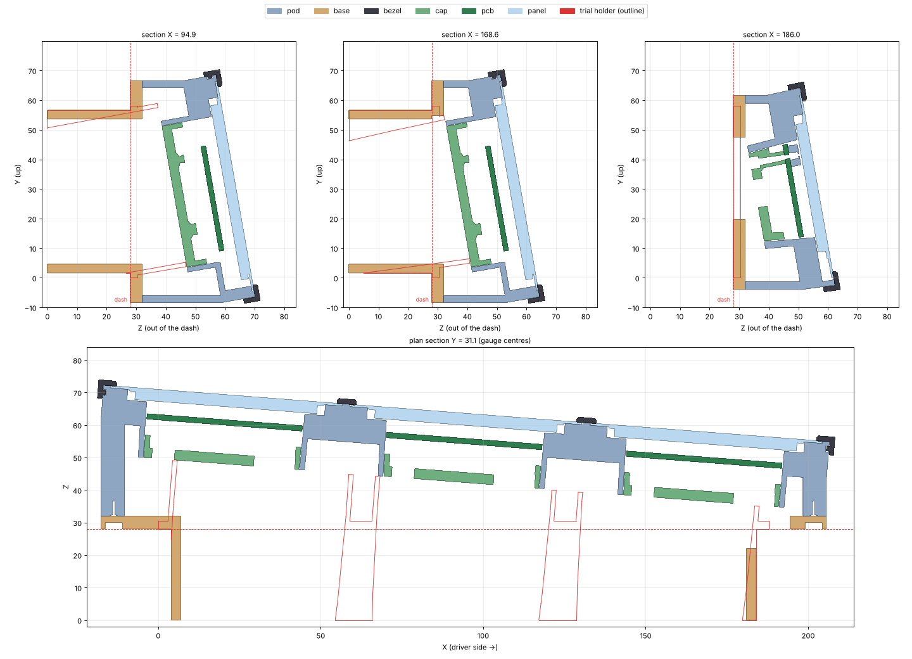

# can2gauge Mk4 triple holder TRI V1.0: three CT gauges in one angled pod

Built on `DIN_Gauge_Holder_Trial.STL`. It keeps the trial's DIN box, which slots into the Mk4's 1-DIN opening, and its viewing angle. All three panels face **10.0° up and 4.45° towards the driver**, as the trial's cups do. The three can2gauges are built into the holder instead of sitting in their own housings: each SFTO210XC-7478A-CT touch panel and rev15 (V3.4) board fits straight into its own head, which has the same pockets, flex cavity, bosses and cap as CT V4.2.

## Why it isn't the trial's size

- **Width.** The touch panel's Ø71.27 lens sets the pitch at **74 mm**: the Ø71.87 recess plus a 2.1 mm web. The trial's 62.5 mm pitch only suits a Ø52 gauge. Three heads in a row come to a stadium-shaped face **224 × 76 mm** (227 × 79 over the bezel). The trial's face is 188 × 58.
- **Depth.** On the dash the footprint is **223 × 75 mm**, centred on the DIN box: **21.6 mm** beyond the box each side and **9.9 mm** above and below it.
  - A can2gauge is 20.9 mm deep from the lens to the back of its cap.
  - The outer heads' tubes and caps sit wider than the 180 mm DIN opening, so they have to stay in front of the dash.
  - The pod therefore sits out along its axis until the lowest point clears the dash by 1 mm. That point is the right gauge's plugs plus 4 mm for the wires to turn.
  - The bezel ends up **24 mm proud of the dash at the right-hand end and 50 mm at the bottom-left corner**. The trial is about 12–24 mm. The 4.45° yaw across 227 mm adds 17 mm at the left. The 10° tilt adds about 13 mm at the bottom.

## Parts

| File | What | Print |
|---|---|---|
| `can2gauge_tri_pod_V1-0.stl` | Three heads merged into one face plate: lens recess, film/LCM pocket, neck pocket, opened-out flex cavity, M2 insert bosses, the three Ø51.8 tubes, and a hollow shroud swept straight back to the rim. 3 mm skin between the heads, 2.4 mm shroud wall. Six M3 rim bosses. | Face down. The pocket and recess ledges need the same supports as V4.x. |
| `can2gauge_tri_base_V1-0.stl` | 4 mm deck on the dash (same footprint as the shroud) with the trial's DIN box under it. Same outside as the trial (180 × 55 × 28), but a 3 mm-wall sleeve rather than solid. The deck is open under the right gauge's cap. The box's right wall has a cable notch down to Z 22 under that gauge's plugs. Six counterbored M3 holes. | Deck top-face down, box up. No supports. The notch top is a 26 mm bridge. |
| `can2gauge_tri_bezel_V1-0.stl` | One snap-on bezel for all three: Ø68 windows, 1.6 mm lip, 0.1 mm bead on each lens. Seven hooks: 3 top, 2 bottom between the heads, 1 at each end. | Face down. |
| `can2gauge_52mm_CT_cap_V4-2.stl` × 3 | The standard CT V4.2 cap, unchanged. | Back face down, no supports. |

The STLs are in the trial's own frame, so they overlay it. In the slicer, use *place on face*. They're watertight and decimated from the 0.2 mm mesh. The pod and bezel are within 0.11 mm of the model (p99 0.07).

## Hardware

- **Head bosses:** 9 × **M2 × 3** heat-set inserts (3 per head), pressed from the PCB side, flush.
- **Caps:** 9 × **M2 × 12**, from the back through the caps, as on the single gauge.
- **Pod rim bosses:** 6 × **M3 × 4** short heat-set inserts (Ø4.0 × 4.6 pockets).
- **Base to pod:** 6 × **M3 × 6** button heads, from the dash side through the deck counterbores (Ø6.6 × 2.0). M3 × 8 bottoms out.
- No brackets.

## Assembly

1. Press the inserts: M2 × 3 into the head bosses, M3 × 4 into the pod rim bosses.
2. Put each panel in from the front, neck at 6 o'clock, lens flat in its recess. With all three in, snap the bezel on.
3. From the back, for each gauge: plug the flex into J_LCD. Lay the PCB on the bosses with the fold in the cavity under the neck. Fit the cap with 3 × M2 × 12, snugged only.
4. Plug the looms. The right gauge's plugs sit over the box's right wall, so run its wires down through the notch.
5. **Flash or set up the gauges now if you need USB.** The left gauge's USB-C ends up over the box wall. After this step it's OTA only.
6. Screw the pod to the base with 6 × M3 × 6 from the back.
7. Push the box into the DIN opening.

On CAN, terminate one end of the chain only (the termination is selectable in the UI). No firmware change is needed: all three panels are neck-down, exactly as in the single gauge.

## Checks (`check.py`, 35 checks, all clear)

For each gauge, the cap, PCB, panel and wire room were checked against the pod, the base and the dash. Base against pod, and bezel against pod and lenses, were also checked.

- **Fit to the bore:** cap skirt 0.25 mm, as on the single gauge.
- **Closest approaches:**
  - right gauge's wire room to the base: 1.06 mm
  - right gauge's wire room to the dash: 1.15 mm
  - right cap to the dash: 5.3 mm
- **Bezel:** sits on the pod. Its beads press each lens 0.1 mm, as on V4.2.
- **Thinnest walls:** the bezel hook pockets come within 1.06 mm of the lens recess at the top of each head and at the ends. That's the same as V4.2.

## Please check before printing

1. **Frame.** I've taken the trial's Y as up and +X as the driver's side (RHD), which is the way its 4.45° yaw points. If that's wrong, the panels would end up neck-up.
2. **Dash surface.** The deck needs the console round the DIN opening to be flat over 223 × 75 mm. The trial's flange only covered 188 × 58.
3. **How far it stands out:** 24–50 mm. If that's too much, the cheapest saving is to **flip the right gauge 180°** (neck up), which brings its plugs over the box. That saves **5.6 mm** across the whole pod, but it needs a 180° display and touch rotation in firmware for that gauge. The other option is less yaw.

## Files

- `triple.py`: the model. `ENC_RES=0.2 python triple.py out/` writes pod, bezel and base.
  - It imports `pod10.py` (CT V4.2) for every head feature, plus `geom.py`, `cap4.py` and `frame.py`.
- `frame.py`: the trial's frame, the axis angle, the DIN box and the 74 mm pitch.
- `place2.py`: solves how far out the pod has to sit.
- `check.py`: the interference checks. `final_check.txt` is the output.
- `sections.py`: the section drawing. Set `TRIAL_STL` to overlay the trial.
- `qem.cpp`: the quadric decimator used on the marching-cubes meshes. Usage: `qem in.stl out.stl 0.0002`.
