# can2gauge

**can2gauge** is a 52 mm round digital gauge with a 2.1" 480 × 480 touch screen. Plug a Bluetooth OBD adapter into
the car, give the gauge 12 V, and it finds the car and sets itself up from your phone: no laptop, no app. It can also
read the car's **CAN bus** or **K-line** directly, an **OpenHaldex** controller, an aftermarket ECU through **usb2ip**,
or 0-5 V sensors through an **adc2can**. With the **can2gauge Link** Android app it shows **Google Maps' next turn** too.

  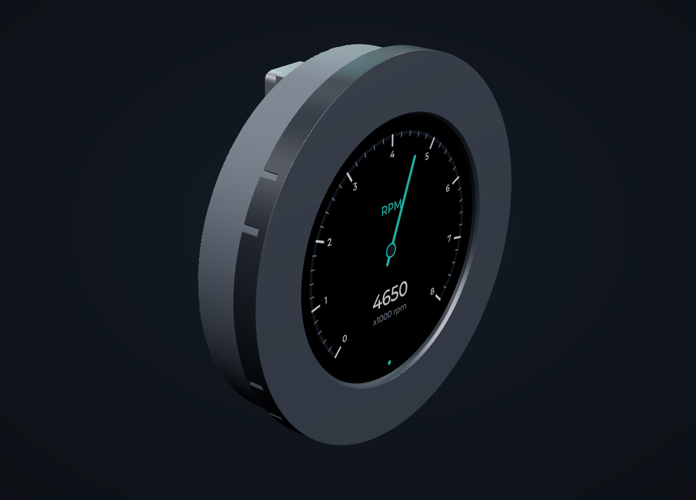
  &nbsp;
  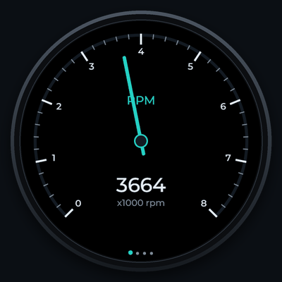

> [!NOTE]
> **Firmware 1.2.2** (1.0.0 was the first full release, board V3.4 "V1.0"). The source code will be published here.
> Some paths still need their first test on a car: see [Still Being Tested](#still-being-tested).

## Contents

1. [What You Need](#what-you-need)
2. [Fitting It](#fitting-it): mounting, the plugs, wiring, more than one gauge
3. [Setting It Up](#setting-it-up): First Boot from your phone
4. [Using It](#using-it): the screen, pages, quick actions, the menu, looks, alerts, navigation, logging
5. [The Web UI](#the-web-ui)
6. [Updating](#updating)
7. [Where the Data Comes From](#where-the-data-comes-from): OBD adapters, Scan My Car, CAN, K-line, diagnostics, OpenHaldex, gearbox, add-ons
8. [Hardware](#hardware)
9. [Still Being Tested](#still-being-tested), [Credits](#credits-and-licences), [Disclaimer](#disclaimer)

---

## What You Need

- **The gauge** with its U-bracket.
- **A 52 mm hole or pod** (A-pillar, vent or DIN pods made for 52 mm gauges).
- **12 V and ground**: a switched (ignition) feed is simplest.
- **One way to read the car**:

| Way in | Wiring | Good for |
|---|---|---|
| **Bluetooth OBD adapter** (most people) | None: it plugs into the OBD port | Any car with OBD-II. See the [adapters that work](#obd-adapters) |
| **CAN bus** | Two wires to the car's CAN | The fastest values, the car's own broadcast, VW / Audi PQ, MQB and MLB |
| **K-line** | One wire to OBD pin 7 | Older VWs (Mk4 era), the ME7 logger, OBD-II on older cars of any make |

Optional extras: [OpenHaldex](#openhaldex), an [adc2can](#adc2can-and-usb2ip) for 0-5 V sensors, a
[usb2ip](#adc2can-and-usb2ip) for an aftermarket ECU, more gauges in a [daisy chain](#more-than-one-gauge), and an
Android phone for [navigation](#turn-by-turn-navigation).

---

## Fitting It

### Mounting

The Ø51.8 mm body goes through a standard 52 mm hole and the U-bracket clamps it from behind. Everything plugs into
the rear cap.

  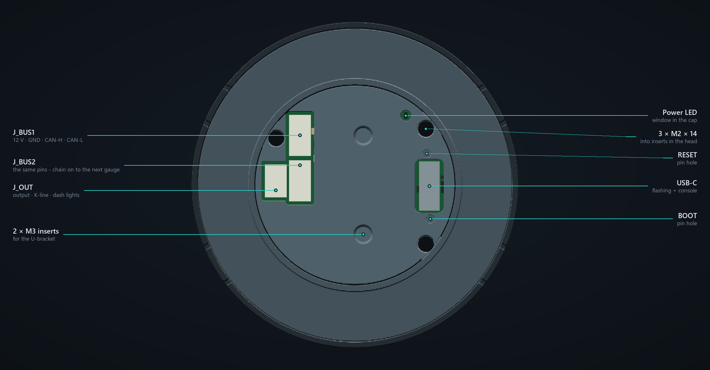

### The Plugs

Three latching JST PA (2.0 mm) plugs on the back.

| Plug | Pin | Signal | Notes |
|---|---|---|---|
| **J_BUS1 / J_BUS2** (PA-4) | 1 | 12 V | Switched feed, or permanent (see [Power](#power)) |
| | 2 | GND | |
| | 3 | CAN-H | The car's CAN, or the next gauge |
| | 4 | CAN-L | |
| **J_OUT** (PA-3) | 1 | OUT | 12 V high-side **or** ground low-side, up to 1.5 A |
| | 2 | K-LINE | OBD pin 7 |
| | 3 | DASH LIGHTS | 58d (PWM or dimmed 12 V) or 58 |

The two bus plugs are wired straight through, so either can take the car and the other goes on to the next gauge.

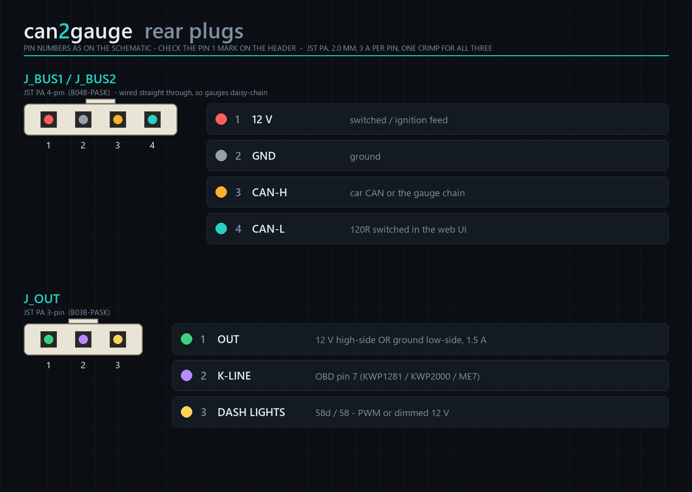

### Wiring

Only power and ground are needed. Add the rest for what you want.

- **Bluetooth adapter only**: 12 V and ground on J_BUS1, the adapter in the OBD port. That's it.
- **CAN**: CAN-H / CAN-L to the OBD port's pins 6 and 14, or to the drivetrain CAN at the gateway for the most data.
  The 120 Ω termination is a setting (**Auto** by default), not a jumper.
- **K-line**: J_OUT pin 2 to OBD pin 7. The pull-up is on the board.
- **Dash lights**: J_OUT pin 3 to the dash-light feed (VAG 58d, or 58) drops the screen to its night brightness with
  the lights on. No wire? The gauge can [dim from the car's headlights](#night-dimming) instead.
- **Output**: J_OUT pin 1 switches a lamp, buzzer or relay from a [trigger](#alerts-and-triggers). Use a relay for
  anything big: in high-side mode the load goes through the gauge's input fuse.

#### Power

On a **switched feed** the gauge is on with the ignition. On a **permanent feed** it takes the ignition from **CAN
terminal 15** (VAG PQ, MQB, any bit you enter, or just bus traffic), the **dash-light wire on an ignition feed**, or
another gauge in the chain. Ignition off plays Rev's goodbye, fades the screen and goes to standby; after 10 minutes it
deep-sleeps. It still draws a few mA asleep, so check before leaving one for weeks.

### More Than One Gauge

Run the harness from the car to the first gauge's J_BUS1, and from its J_BUS2 to the next. Leave termination on
**Auto**, or switch it on at the last gauge only. Gauges also link over WiFi with no chain wire at all: a new gauge
finds the others by itself. One gauge reads the car and the rest follow.

---

## Setting It Up

### First Boot

1. **Ignition on.** A new gauge asks *Set this gauge up from your phone?* Tap **Yes**.
2. **Join its WiFi**, `can2gauge-XXXX` (no password until you set one), and open **`http://192.168.1.1`** or
   **`http://c2g.local`**. The First Boot page opens by itself.
3. **Let it look.** It checks every way in (CAN, OBD, K-line, a Bluetooth or WiFi adapter, OpenHaldex, adc2can,
   usb2ip, other gauges). A Bluetooth adapter it finds is paired there and then. When there's a way in it runs
   [Scan My Car](#scan-my-car) too.
4. **Pick your gauges**, then **Finish** (or **Apply**). Nothing changes until you press it.

**Just an OBD adapter?** You get one card: *Found your car* (the adapter, the car from its VIN, the units) and a
starter set of gauges for what the car can show. The gauge is set for a switched 12 V feed. **Show All Settings**
opens the full page.

**Anything more** (CAN, K-line, add-ons) gets the full page: what was found, one row per suggested setting with the
reason (CAN profile and the car's DBC, K-line, power, dimming, units, colours, boot logo, menu items), the gauges and
[triggers](#alerts-and-triggers), and **Your Car**: the car its VIN says it is, as a picture in its paint. Press **This
Is My Car**.

The screen shows a **SETTING UP** ring while it works, then **SET UP**. **Settings > Device > First Boot Setup** runs
it again.

  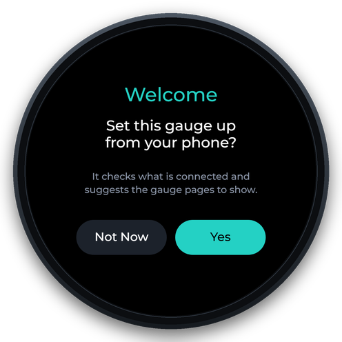
  &nbsp;
  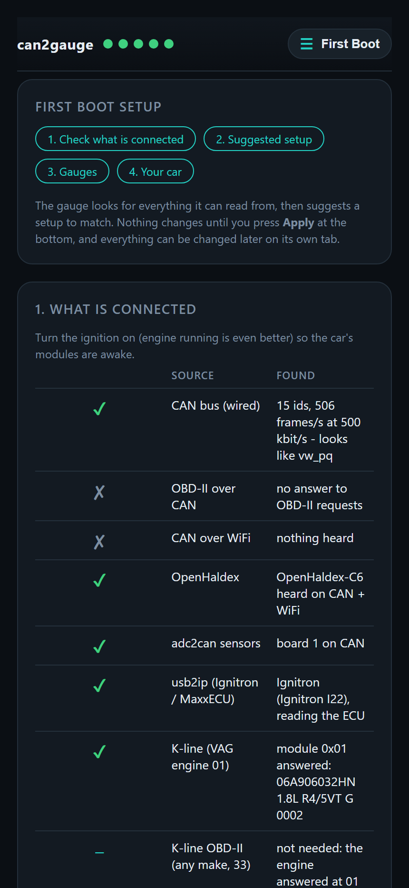
  &nbsp;
  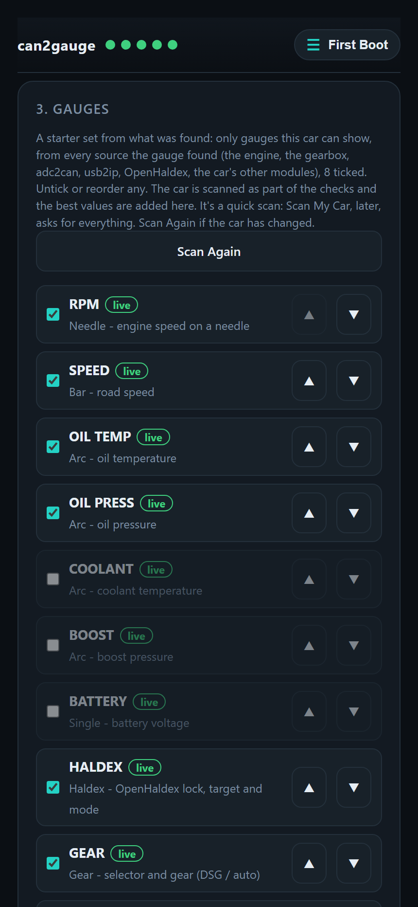

### Several Gauges

Set up any one of them. With the others heard, **Set Up the Other Gauges the Same** gives them the same gauges,
triggers and car settings when you press Apply. Each keeps its own WiFi, wiring and number, and starts on its own page
by its place in the row. The gauges need the same firmware first (Daisy Chain > **Update All Gauges**).

**Number them**: menu > Daisy Chain > **Set Numbers** puts a **?** on every gauge. Tap them left to right and each
takes the next number. It ends by itself once all have one (or **Done**, or **Cancel** to keep the old numbers). The
numbers decide each gauge's start page and the order of the row wave.

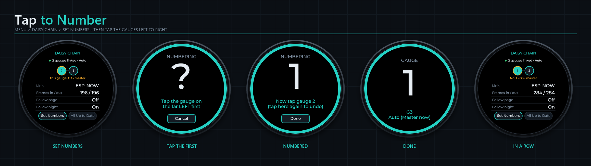

---

## Using It

### On the Screen

| Do this | On a gauge page |
|---|---|
| **Swipe** left / right | Next or previous page (up to 8) |
| **Tap** | The sprite reacts; on a Haldex page, the [Haldex quick settings](#openhaldex) |
| **Double tap** | Start this page's peak again |
| **Pull down** | [Quick actions](#quick-actions) |
| **Pull up**, or **hold** 1.5 s | [The menu](#the-menu) |

A page waiting for data says why under the value (*"No OBD adapter paired"*, *"Waking module 0x01"*). A value that
stops arriving shows `--`.

### Pages

Every page is one of twelve styles, and any value can go on any page with its own range, redline, decimals and label.

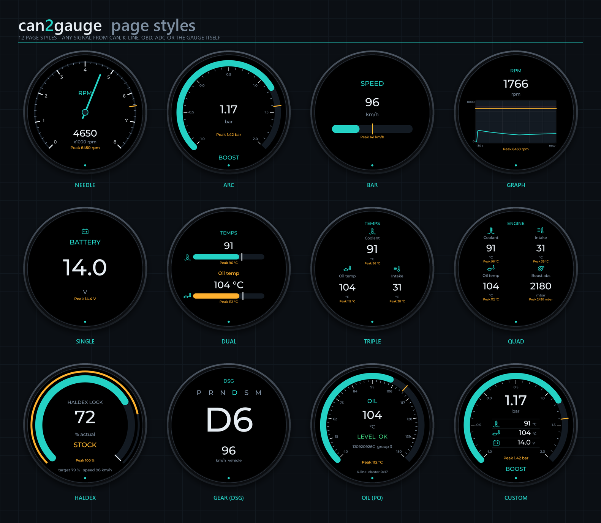

**Needle**, **Arc**, **Bar**, **Graph** (the last 30 s), **Single**, **Dual**, **Triple**, **Quad** (2 × 2), **Haldex**
(target and actual lock), **Gear** (P R N D S M and the gear), **Oil (PQ)** (the OEM oil temperature and level) and
**Custom** (an arc with three readouts in the middle). Any page can show **Rev**, the can2gauge mascot, instead of its
dial. Values carry their icons and their own decimals (lambda reads 1.00).

**Setting up a page**: the web UI's **Gauges** tab. Open a page, pick its **Style**, its **Source** (**Car** lists
everything [Scan My Car](#scan-my-car) found, with a Find box) and its value; a sensible range, redline and decimals
fill in by themselves. **More Options** has Min, Max, Redline, Decimals, Sprite and **Peak Marker**. **Move Up / Down**
sets the swipe order. Changes show on the screen straight away and save by themselves.

The page on the screen is read as fast as the source allows (about 13 values a second through a good adapter); the
others start the moment you swipe to them.

### Quick Actions

Pull down on a gauge page:

- **Layout**: steps the page through the styles its values suit.
- **Peak Values**: this page's peak marker on or off.
- **Sprite**: Rev on this page or off.
- **Units**: this reading's units, metric ↔ imperial (bar / psi, °C / °F ...): every page and gauge follows.

It saves and closes with **Back**, a hold, or after 10 s.

  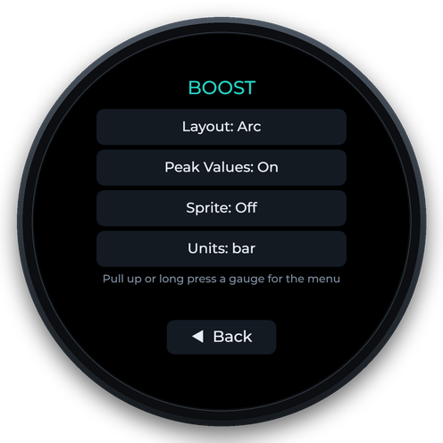

### The Menu

Pull up (or hold) for the menu: one item per screen with a live status. Swipe for the next, tap to open, hold or wait
10 s to go back. Items for things you don't have are hidden (Settings > Device > **Menu and Tabs**, which hides the
web UI tab too).

  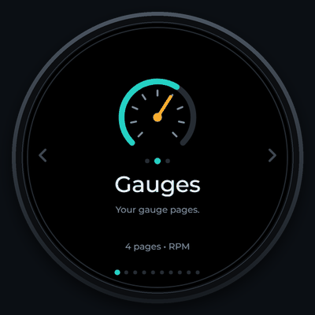

| Item | What's behind it |
|---|---|
| **Gauges** | Back to the pages |
| **Navigation** | The phone link: **Off**, **Pop Up** or **Route** |
| **CAN Bus** | Every ID on the bus, decoded with the car's DBC, or raw |
| **Haldex** | The Haldex gauge: swipe to change the OpenHaldex mode, tap for its quick settings |
| **ADC / usb2ip / Oil** | The adc2can sensors, the ECU over WiFi, the OEM oil temperature and level |
| **K-Line** | Wakes the module picked in the web UI and shows its measuring blocks |
| **Gearbox** | Selector and gear full screen, speed, temperature, lock-up |
| **Bluetooth OBD** | The adapter's connection, then pages of live PIDs |
| **Triggers** | Each trigger: fired, or what it reads now |
| **Daisy Chain** | Every gauge in the row, **Set Numbers**, and **Update Now** |
| **Output** | The output, what's switching it, and the dash-light state |
| **Drag Timer** | [0-100 km/h](#drag-timer) |
| **Settings** | Brightness, Screensaver, Units, Boot Logo, Theme, Number Font, Reboot |

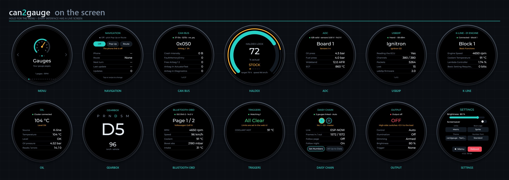

### Looks

- **Themes**: 71. 65 manufacturer cluster colours across 31 makes (VW blue, Audi red, BMW amber ...), house palettes,
  Custom, and **Match Car**, which picks the make and era from the VIN.
- **Number fonts**: the readings in the style of VDO, Smiths, Stack / Autometer, Defi, a digital LCD, VW, Audi, BMW or
  Ford.
- **Boot logos**: can2gauge (its dial sweeps like a cluster), Forbes, OpenHaldex, your text, 33 make logos, **My Car**
  (a picture of your car in its paint), **Sprite** (Rev wakes up and the gauges in a row wave hello) or **any image**
  (converted in the browser).
- **Screen rotation**: **Upside Down**, and **Rotation Trim** (±15°) for a gauge that sits crooked. Touch follows.

In a daisy chain, theme, font, brightness, units and boot logo are shared: change them on any gauge.

The number fonts

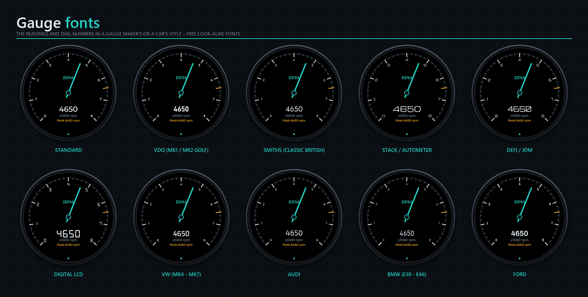

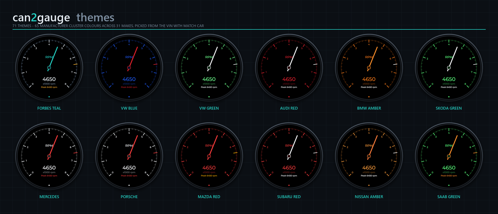

### Rev, the Screensaver and Rev Runner

**Rev** is the can2gauge mascot: a white figure whose quiff is a gauge needle. On an rpm page he idles, runs and
sprints with the revs, bounces off the limiter and blows off when the boost drops; on a Haldex page he braces for the
lock. On any page you pick his **reaction** to the value going past its redline (Overheating, Thirsty, Low Battery,
Panic ...). At ignition off he waves goodbye, along the row in a chain.

The **screensaver** (Settings > Logo & Sprites, off by default) brings Rev up once the car is still and the screen
untouched. Double-tap it for **Rev Runner**, a jump-the-cones game (the brake pedal jumps too, on a CAN car).

  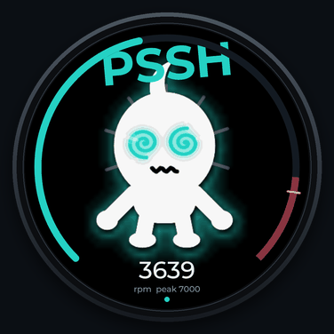

### Alerts and Triggers

**Triggers** (web UI) are 8 set-points on any value: above or below, hysteresis, hold time and latch. Each raises an
**alert** (a red pulsing card over any page), switches the **output**, or both. **No Reading** decides what a failed
sensor does. First Boot suggests a set for the values your car has.

  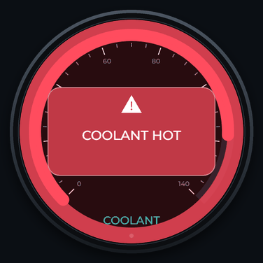

### Night Dimming

With the dash-light wire fitted, the screen drops to its night brightness with the lights on. No wire? Scan My Car
reads the body computer (VW group) and, when it finds the low beam, sets **Output / Lights > Dim the screen > When the
car's headlights are on**. In a chain, one gauge dims them all.

### Turn-by-Turn Navigation

**can2gauge Link** for Android reads the turn Google Maps already shows and sends it over Bluetooth LE. Maps isn't
changed and Android Auto isn't needed. Download it from **[can2gauge.com/app](https://can2gauge.com/app)** (Android
8.0+) and keep it on the same version as the gauge.

- Web UI > **Navigation** > switch **Nav Link** on. In the app allow notification access and Bluetooth, and set
  battery use to Unrestricted. **Show Test Turn** tries it with no phone.
- It **pops up near a turn** (300 m by default) or shows the **whole route**. A tap goes back to the gauges.
- In a chain, switch it on in one gauge only. Android only: iOS doesn't let apps read other apps' notifications.

  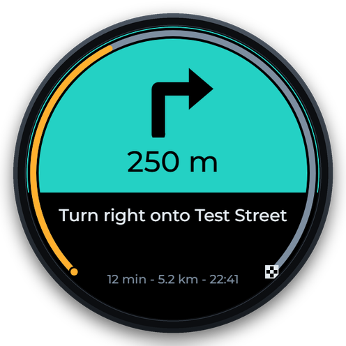

### Drag Timer

Menu > **Drag Timer** times **0-100 km/h** (or 0-60 mph). Tap with the car still: a 5 s countdown under the green
flag, then the clock runs (or starts the moment the car moves). The chequered flag lifts at the finish. Double-tap for
the **best 10**; the web UI's Log tab has them too. It's as exact as the speed source: best over CAN.

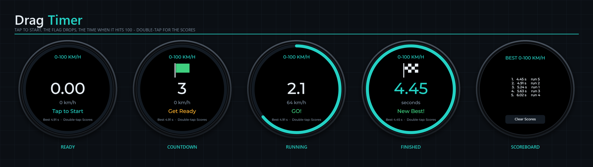

### Data Logger and Fault Codes

- **Log** tab: up to **16 values**, 1-50 times a second (what your pages show, or 16 you pick). Live **graphs** on
  the phone, **Download CSV** for Excel, MegaLogViewer or Datazap. Up to 4 MB in memory (about 1 h 40 min of 16 values
  at 10 a second); a power cut loses it, so download first.
- **Service** tab: **read and clear fault codes** on any module (K-line, CAN or the adapter; OBD-II on any make), with
  descriptions for the standard codes, **Scan Modules**, and the **throttle body adaptation** (060 / 098) over the
  K-line.

> [!WARNING]
> Ignition on, engine off for an adaptation. Clearing an engine's faults also resets its emissions readiness monitors.

---

## The Web UI

Join the gauge's WiFi and open **`http://192.168.1.1`** or **`http://c2g.local`** (some Android phones need the
number while on mobile data). Changes save by themselves. With nobody connected the WiFi sleeps until you open the menu
on the screen (**WiFi stays on** in Settings > WiFi turns that off).

Each card shows the everyday settings; **More Options** holds the fine-tuning and the **(i)** on a title the help.
The **Advanced** switch opens every More Options and shows the tool tabs. Tabs for things your car doesn't have stay
hidden.

  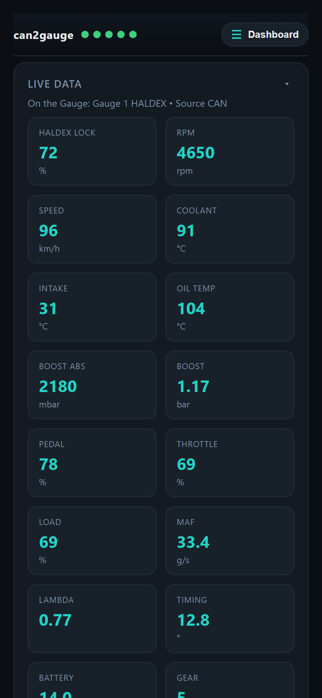
  &nbsp;
  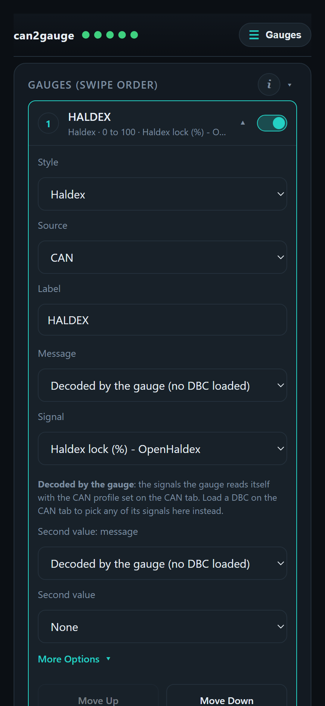
  &nbsp;
  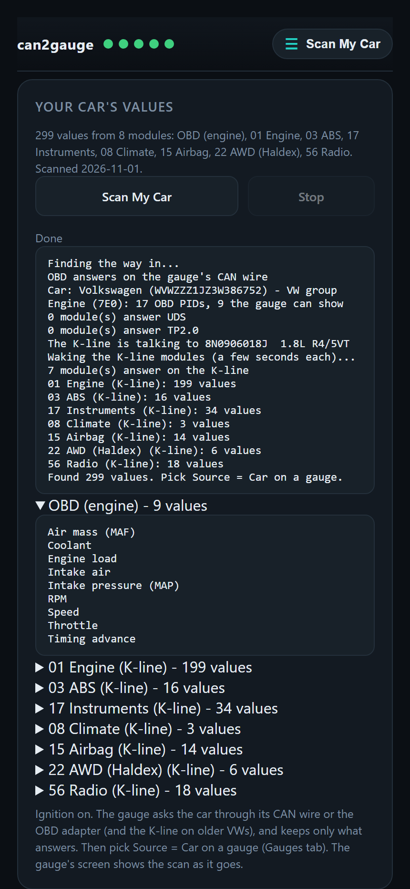

| Tab | What it's for |
|---|---|
| **Dashboard** | Live values, a tile per menu item, Haldex buttons, **Gauge Control** (works the screen from the phone) |
| **Gauges** | The [pages](#pages) |
| **Scan My Car** | [Finds every value the car can show](#scan-my-car), with **Add to Gauge** and **Suggested Gauges** |
| **Log** | The [data logger](#data-logger-and-fault-codes) and the drag timer's scores |
| **Navigation** | The [phone link](#turn-by-turn-navigation) |
| **Triggers** | The 8 [set-points](#alerts-and-triggers) |
| **Service** | [Fault codes](#data-logger-and-fault-codes), Scan Modules, throttle body adaptation |
| **CAN**, **K-line / ME7**, **Bluetooth OBD**, **Gearbox**, **Oil** | Each [source](#where-the-data-comes-from)'s settings and live view |
| **OpenHaldex**, **ADC**, **usb2ip** | The [add-ons](#openhaldex) |
| **Daisy Chain** | The gauges heard, numbers, follow options, **Update All Gauges** |
| **Settings** | **Display** (brightness, units, theme, font, rotation), **Logo & Sprites**, **Power & Wiring**, **WiFi**, **Device** (Your Car, Menu and Tabs, backup, First Boot, factory reset) |
| **Diagnostics**, **System** | Advanced: [measuring values](#diagnostics-uds--tp20) from any module; the gauge's own health |
| **OTA** | [Updates](#updating) |

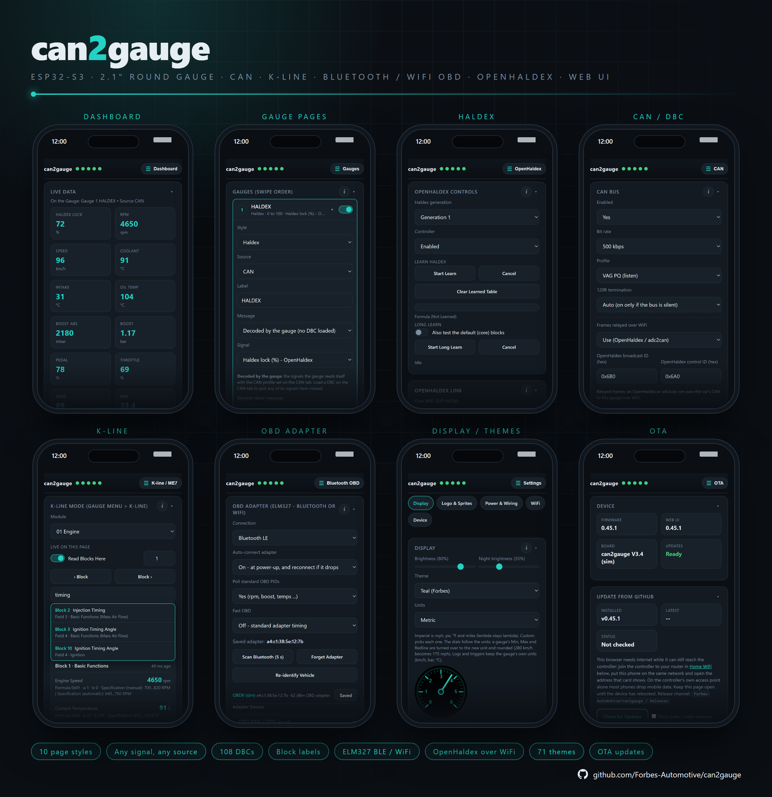

---

## Updating

**Over the air** (OTA tab): **Update from GitHub** (directly, or through the **Home WiFi bridge**), or **Update from
Files** (`littlefs.bin`, then `firmware.bin`). A new firmware must confirm itself within 60 s or the gauge rolls back.

**By USB** from the [Forbes Automotive updater page](https://forbes-automotive.com/pages/module-software-updater) in
Chrome or Edge.

**Gauge to gauge**: update one, then **Update All Gauges** (web UI, Daisy Chain tab) or **Update Now** (menu > Daisy
Chain) on any gauge. The newest firmware goes to the others over WiFi, one at a time, about a minute each. Park first.

> [!WARNING]
> **1.2.2 resets every setting once** (the paired OBD adapter is kept). Press **Download Backup** (Settings > Device)
> before updating and **Import Backup** after. Update every gauge in a chain together: older gauges no longer share
> settings with 1.2.2.

> [!WARNING]
> **A gauge that has only ever been updated over WiFi from before 0.39.8 can't save its settings** (its settings store
> is too small, so it starts on the defaults every time). The boot log and the web UI say so. Update it **once by USB**
> (bootloader, partitions, firmware and filesystem); after that WiFi updates are fine.

---

## Where the Data Comes From

Every source writes into one catalogue of values, and every page, trigger, log and gauge in the chain reads from it.
Most of this is set up by [First Boot](#first-boot) and [Scan My Car](#scan-my-car).

### OBD Adapters

An **ELM327-type adapter over Bluetooth LE or WiFi** gives the gauge the car with no wiring. The ESP32-S3 has
**Bluetooth LE only**, so a Bluetooth adapter must be a BLE ("iPhone compatible") one: SPP-only "Android" adapters and
the OBDLink MX+ / LX won't work.

| Adapter | Link | Notes |
|---|---|---|
| **Vgate iCar Pro BLE 4.0** | BLE | The reference |
| **OBDLink CX** | BLE | Recommended |
| **Veepeak OBDCheck BLE / BLE+** | BLE | |
| **vLinker MC+ / BM+ / FD** | BLE | "FD" means Ford MS-CAN, not CAN FD |
| Generic BLE ELM327 clones | BLE | Slower; can't wake VAG modules |
| Any **WiFi ELM327** | WiFi | Usually 192.168.0.10:35000; the gauge's own WiFi stays up |

- **Paired once**: it connects by itself at power-up, and stays paired through updates and backups (only **Forget**
  or **Factory Reset** unpairs it). An adapter that isn't there stops being looked for after about a minute.
- **11 and 29-bit CAN cars**, **VIN**, every standard PID, **UDS to any module** (gearbox, AWD ...), the car's CAN
  broadcast, VW **TP2.0** and VAG K-line blocks through the adapter.
- **Fast**: the page on the screen gets every turn; values from a module are asked three at a time, and the first
  read of each module probes how fast it can go (kept per car, **Probe Speed Again** on the Bluetooth OBD tab).
- **Bench tests** on the Bluetooth OBD tab try a new adapter's paths.

| Through an adapter | Yes | No (needs the gauge's own wiring) |
|---|---|---|
| | OBD-II PIDs, VIN, UDS, fault codes, KWP2000 engine blocks, TP2.0 (with raw CAN) | **KWP1281** (Mk4 blocks, cluster oil level), the ME7 logger and flash read, throttle body adaptation |

### Scan My Car

One button (its own tab, and part of First Boot) asks the car what it can show, so nobody needs to know about PIDs,
DIDs or measuring blocks. Ignition on.

1. It finds the **way in** (CAN, the adapter, or the K-line) and the car from its **VIN**.
2. It finds the **modules fitted** and identifies each (part number, software). Engine and gearbox are ticked; tick any
   others.
3. It **deep-scans** the ticked ones: the OBD PIDs each answers, and the module's own values from the **value
   library** (maker data for the VW group, BMW, Ford, GM, Hyundai / Kia, Mazda, Mercedes, Nissan, Renault, Toyota,
   Volvo and more, plus [OBDb](https://github.com/OBDb)). Older VWs are read over TP2.0 or the K-line; older cars of
   any make over **OBD-II on the K-line**.

Then **Add to Gauge** beside any value, **Fill the gauges from this scan**, or **Suggested Gauges and Triggers** (the
same starter set First Boot makes). The result is the **Car** source on every page. The screen shows **SCANNING**, then
**SCANNED** and the count.

  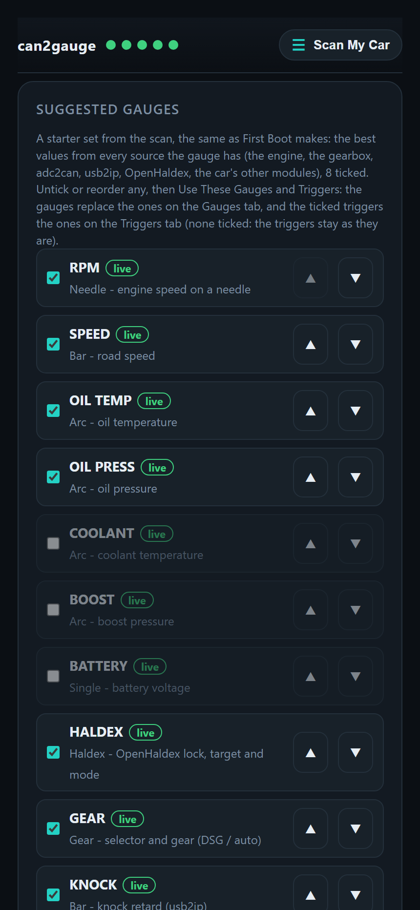
  &nbsp;
  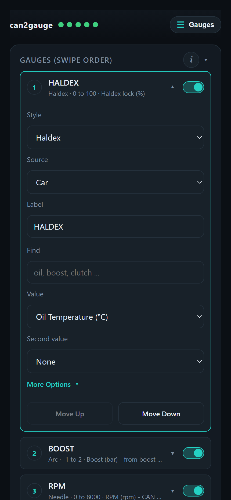

**Enable Other Scanners** (Settings > Device) stops the gauge asking the car anything until the next restart, so
another scan tool can have it.

### CAN

Classic CAN, 500 kbps, listen-only unless a profile asks.

- **Profiles**: **VAG PQ** (rpm, pedal, coolant, intake, boost, speed, fuel litres, gear, oil temperature and
  pressure warning), **VAG MQB**, **VAG MLB** (Audi C7 / D4 / Q5 8R with the ZF 8HP), **OBD-II** (asks, up to six PIDs a
  request, alongside a profile too) and **MaxxECU**. OpenHaldex (0x6B0) is always decoded.
- **Any DBC**: 108 opendbc DBCs on the gauge (VW / Audi translated to English), ranked against the IDs on the bus to
  identify the car, or your own `.dbc` converted in the browser. **Three at once**, and they can feed the gauge's own
  values: included for **EMU Black, MaxxECU, Link and Haltech**.
- **Termination Auto** switches the 120 Ω on only when nothing else terminates the bus. The gauge wakes a sleepy
  gateway and recovers from bus-off by itself.

### K-line

An L9637D on OBD pin 7.

- **KWP1281 and KWP2000** VAG measuring blocks, with field names and specs from **501 module label files** picked by
  part number. Browse any module on the screen or in the web UI.
- **OBD-II on the K-line** (ISO 9141-2, KWP2000) for any make, about 7-15 answers a second, VIN included.
- **ME7 logger**: upload the `.ecu` from ME7Info and tick the variables: about 34 samples a second, or about 50 with
  **Fast** (a tiny routine in the ECU's RAM, never the flash).
- **ME7 flash read**: a read-only 1 MB dump to a `.bin`. Nothing is ever written.

### Diagnostics (UDS / TP2.0)

The **Diagnostics** tab (Advanced) reads up to **32 measuring values** from any modules, any make: **UDS** on modern
modules, **KWP2000 over TP2.0** on VW PQ-era ones, over the CAN or the adapter. Any request / answer ID (11 or 29-bit,
BMW extended addressing), any run of bits, scale and offset; a **Try a DID** box; and the **DID Library** to search and
**Add**. Scan My Car fills these slots for you. **Turbo** packs values into one request and reads them back to back.

### OpenHaldex

can2gauge started as the OpenHaldex companion display.

- Lock target and actual, mode and more over **CAN** or **WiFi** (OpenHaldex broadcasts it with no pairing).
- **Swipe** the Haldex screen to change mode. **Tap** a Haldex page for its quick settings: the **generation** (Set),
  **Learn**, **Standalone** and **Use CAN** (two taps each, car stopped), and which OpenHaldex is linked.

  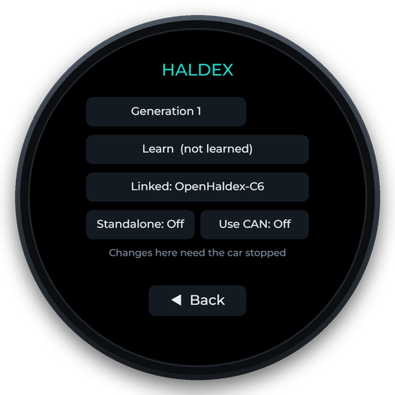

### Gearbox

DSG and **ZF 8HP** (Audi / VW and BMW): selector and gear from the CAN broadcast (PQ, MQB, MLB), plus lock-up, input
speed and slip on MQB / MLB. Diagnostic reads (UDS or TP2.0, CAN or adapter) for gear, oil temperature and selector;
Scan My Car sets them up for a VW gearbox it finds.

### OEM Oil

Mk4-era VAG cars with the **G266** sender: oil temperature from the CAN, or temperature **and level** from the cluster
over the K-line, on the **Oil (PQ)** page.

### adc2can and usb2ip

- **adc2can**: up to two boards, 16 × 0-5 V sensors, over the CAN or WiFi. Each sensor's scaling and dial range come
  from the adc2can and can be edited from the gauge's ADC tab.
- **usb2ip**: Forbes Automotive's wireless USB bridge for an **Ignitron, MaxxECU, Link (G4X / G5), Haltech (Elite /
  Nexus)** or **ECUMaster EMU PRO**. The everyday values fill the gauge's own, and **every channel** can go on a page
  (Source = ECU).

### Daisy Chain

One gauge (the **master**) reads the car and shares every value over CAN or WiFi; the rest follow its ignition, night
dimming and, if you like, its page. Shared settings (ignition, shutdown, screensaver, theme, font, brightness, units,
boot logo) match on every gauge.

  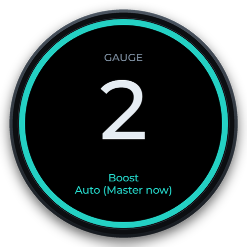
  &nbsp;
  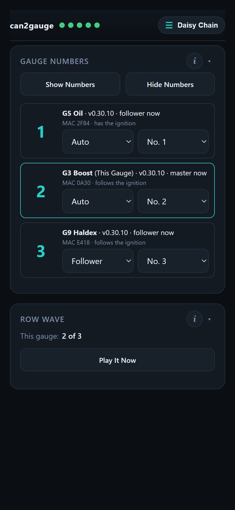

---

## Hardware

A standard 52 mm gauge: a Ø51.8 body, a Ø76 head carrying the touch screen under a snap-on Ø79.2 bezel, a rear cap
with a window per plug, and a U-bracket. Housing files and notes: [Enclosures/](Enclosures/README_CT.md).

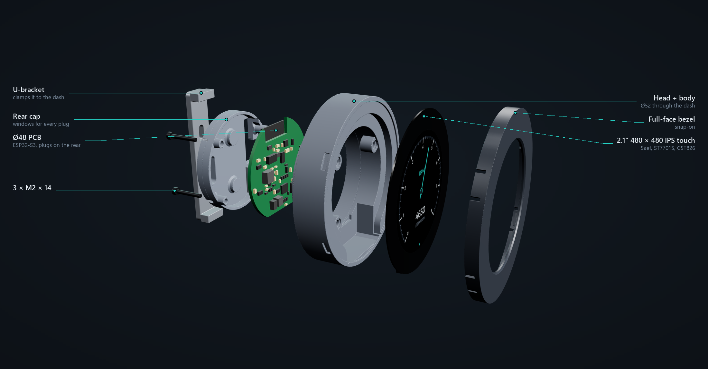

A Ø48 mm, 4-layer board sits behind the screen.

| Block | Parts | Notes |
|---|---|---|
| MCU | ESP32-S3-WROOM-1-**N16R8** (16 MB flash, 8 MB PSRAM), USB-C, BOOT / RESET | Arduino and LVGL 9 |
| Display | Saef SFTO210XC-7478A-CT, 2.1" 480 × 480 IPS, ST7701S | CST826 capacitive touch |
| 12 V in | Pass-through plugs, input PTC, SMF24CA TVS, SS54 | Power and CAN arrive together on either plug |
| 5 V / 3V3 | TPS62933 buck, CH213K OR-ing with USB, AMS1117-3.3 | Runs from USB on the bench |
| Backlight | AL8860 constant-current **from 12 V** | Stays dark on USB power alone |
| CAN | TCAN1044V, PESD2CAN, switched 120 Ω | Classic CAN only |
| K-line | L9637D, tester pull-up | Fast enough for ME7 at 56000 baud |
| Output | DRV8876 half-bridge | High- **or** low-side, 1.5 A limit, protected |
| Dash lights | Peak detector | 12 V, dimmed 12 V or 58d PWM |
| I/O expander | TCA9554 | LCD and touch reset, termination, output, dash-light and fault inputs |

The same firmware also runs on the **Waveshare ESP32-S3-Touch-LCD-2.1** development board.

ESP32-S3 pin map

| Group | Signal | GPIO |
|---|---|---|
| LCD RGB | DATA0-15 (B1-5, G0-5, R1-5) | 42, 45, 48, 47, 21 · 14, 13, 12, 11, 10, 9 · 46, 3, 8, 18, 17 |
| LCD timing | HSYNC / VSYNC / DE / PCLK | 38 / 39 / 40 / 41 |
| LCD init (3-wire SPI) | SCK / SDA | 2 / 1 |
| Backlight | AL8860 CTRL | 6 |
| I2C | SDA / SCL (TCA9554 0x20, touch 0x15) | 15 / 7 |
| Touch | INT | 16 |
| CAN | TX / RX | 4 / 5 |
| K-line | TX / RX | 44 / 43 |
| USB | D- / D+ | 19 / 20 |
| Boot | BOOT button | 0 |

| TCA9554 port | P0 | P1 | P2 | P3 | P4 / P5 | P6 (in) | P7 (in) |
|---|---|---|---|---|---|---|---|
| Signal | LCD_RST | TP_RST | LCD_CS | CAN_TERM_EN (low = 120 Ω in) | DRV8876 IN1 / IN2 | Dash lights | Output fault |

The board and schematic

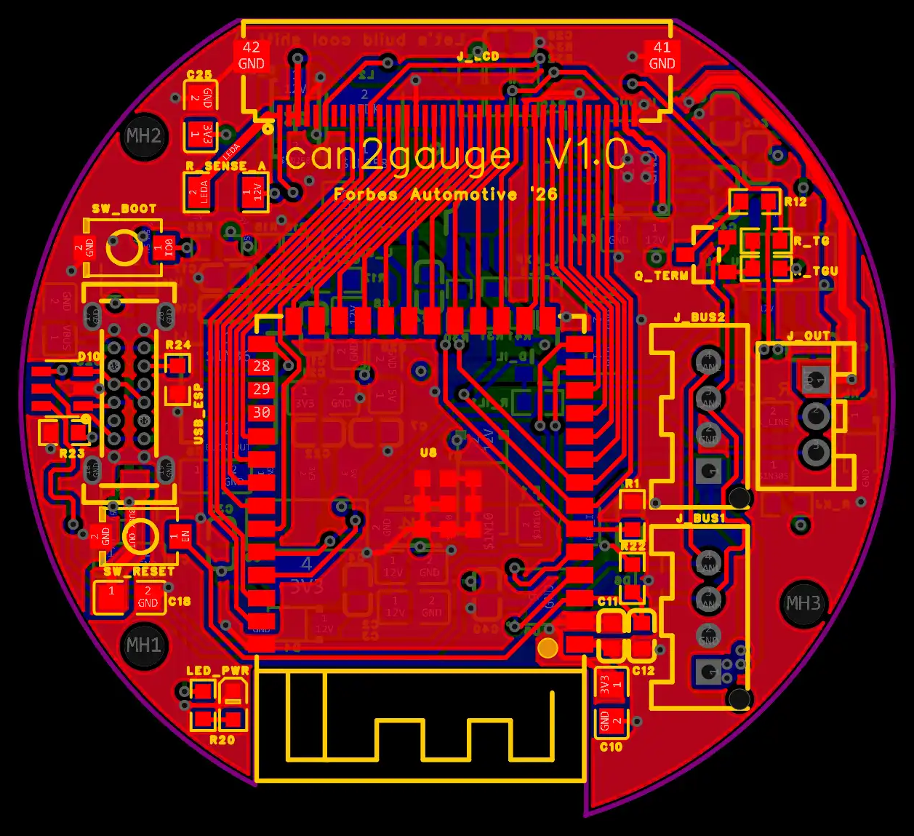

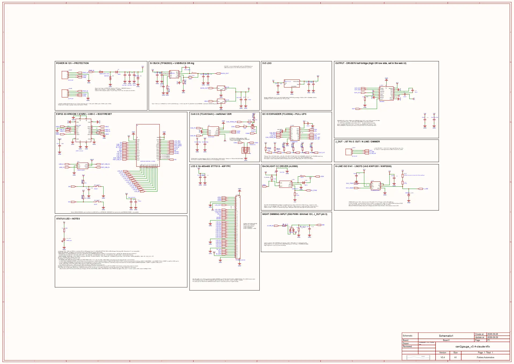

The EasyEDA Pro project and the BOM are in [PCB/](PCB/).

---

## Still Being Tested

Written but not yet proven on a car or the bench:

- **1.2.x**: Tap to Number, the Sprite boot logo's hello wave, per-page peak markers, and settings saving on gauges
  updated by USB from the old layout.
- **Reading speed** (1.1.3): the module speed probe and grouped reads on cars other than the 2025 Tiguan.
- **Night dimming from the headlights** on a car whose body computer answers.
- **Scan My Car** on a PQ-era VW (TP2.0), a Mk4 (K-line) and non-VW cars, and the maker value lists by make.
- **usb2ip** with Link, Haltech and EMU PRO (EMU PRO channel names unconfirmed).
- **ZF 8HP** on a BMW X5 F15 through the adapter and on an Audi / VW MLB car.
- **K-line**: the ME7 Fast logger on more ECUs, the flash read on an unmodified ECU, the cluster oil level on a G266
  car, and OBD-II over the K-line on other makes.
- **Daisy chain** across three gauges: shared settings, the row wave, and Update All Gauges with a power cut half way.
- **Drag timer** against a GPS timer, and the **Nav link** on a real phone and route.
- **Asleep current** on a permanent feed.

---

## Credits and Licences

- **opendbc** (comma.ai, MIT): the DBC library.
- **OBDb** ([github.com/OBDb](https://github.com/OBDb), CC BY-SA 4.0): the DID library, shared under the same licence.
- **OBDex** ([github.com/foerbsnavi/OBDex](https://github.com/foerbsnavi/OBDex), CC0): the fault code descriptions.
- **Waveshare ESP32-S3-Touch-LCD-2.1** (MIT): the ST7701S start-up sequence and display pin map the board started from.
- **NefMoto ME7 flasher** ([github.com/NefMoto/NefMotoOpenSource](https://github.com/NefMoto/NefMotoOpenSource), GPLv3):
  the read path behind the ME7 flash dump, ported read-only.
- **LVGL**, **NimBLE-Arduino**, **ESPAsyncWebServer / AsyncTCP** (mathieucarbou) and **ArduinoJson**.
- **uPlot** (Leon Sorokin, MIT): the Log tab's graphs.
- **Espressif esp-bsp / esp_lvgl_port** (Apache-2.0): the ESP32-S3 SIMD blend routines.
- **MaxxECU**: its published "Default CAN output" specification.
- **Kile Thomson at Rokketek** (RokketGauge): the Simos 18 values, their scaling and how fast the engine can be asked.
- The gauge fonts are free (SIL OFL) look-alikes; the makers' names describe the style only.
- Thanks to **Garage Tinkering's Ultimate Gauge Board** for the inspiration.

## Disclaimer

Forbes Automotive accepts no responsibility for any incidents arising from the use of this gauge. It reads, and in a
few places requests, data on the car's diagnostic buses. IDs, scalings and protocols vary by vehicle, so check them
against your own car before relying on any value, trigger or output, and never run diagnostics while driving.
